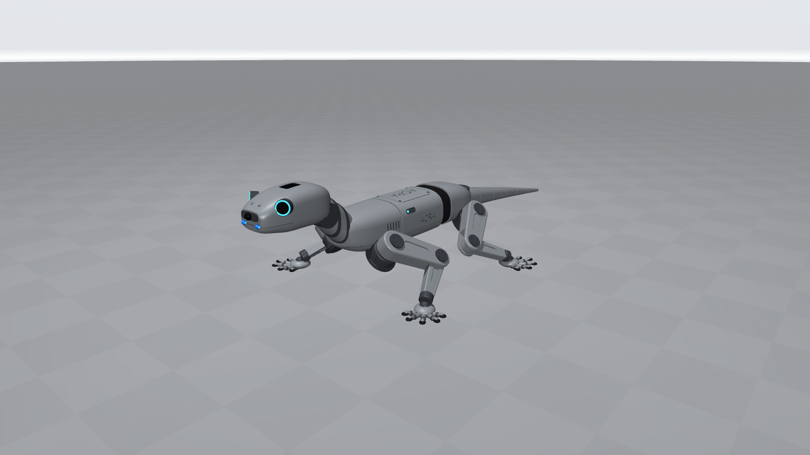
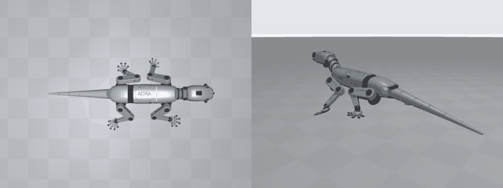

# ACRA lizard quadruped: FreeCAD → MuJoCo → PPO

Gecko-style quadruped from the reference renders, built as a manufacturable robot with the fewest joints that still give a lizard walk.



More pictures in [`images/`](images/): four views (`views.png`), top view, head, gecko foot, body details, the FreeCAD model (`freecad.png`) and the trained walk (`walk.gif`).

| File | What it is |
|---|---|
| `freecad_build.py` | Builds the model in FreeCAD, writes `acra.FCStd`, `acra_step.zip` and `meshes/*.stl` |
| `acra.FCStd`, `acra_step.zip` | Coloured FreeCAD document and STEP assembly (zipped) in the neutral standing pose |
| `images/` | Renders of the model, the FreeCAD model and the trained walk |
| `runs/` | The trained policy (`runs/latest` names it) |
| `meshes/*.stl` | One mesh per rigid body and finish, in that body's MuJoCo frame (mm) |
| `acra.xml` | MuJoCo model |
| `train.py` | `AcraEnv` (Gymnasium) and PPO training |
| `visualiser.py` | Real-time viewer for a trained or random policy |

## Run

**Quick start (just watch it walk):** download the repository as a ZIP from https://github.com/PyroOurson/claudecode/archive/refs/heads/mainbranch-claude-code.zip, unzip it, open a terminal in `ClaudeScripts/acra/` and run the first two commands below (create the environment, install the packages), then `.venv/bin/python visualiser.py`. The trained policy is included in `runs/`, so no training is needed. Use the arrow keys to steer it.

Needs Python 3.10+ (current MuJoCo wheels no longer support 3.9).

```bash
python -m venv .venv
```
```bash
.venv/bin/pip install -r requirements.txt
```
```bash
.venv/bin/python train.py --steps 40000000 --envs 24 --seed 0
```
```bash
.venv/bin/python train.py --resume --steps 4000000
```
```bash
.venv/bin/python visualiser.py
```
```bash
.venv/bin/python visualiser.py --run 20261024-144731
```
```bash
.venv/bin/python visualiser.py --random
```

On macOS the passive viewer must be started with `mjpython` instead of `python` (`.venv/bin/mjpython visualiser.py`). On Windows use `.venv\Scripts\python.exe`.

Rebuild the geometry: run `freecad_build.py` from FreeCAD's Python console (coloured FCStd/STEP), or `freecadcmd freecad_build.py` (geometry and meshes only). Do not rebuild while a training run is starting: it rewrites the meshes the environments load.

Viewer keys: Up/Down forward speed ±0.1 m/s, Left/Right yaw rate ±0.2 rad/s, Space pause, R reset, + / - double / halve playback speed.

Each training run writes `runs/<timestamp>/` with `checkpoints/`, `logs/progress.csv`, `policy.zip`, `vecnormalize.pkl`, `config.json` and `summary.json`. `runs/latest` is a one-line text file holding the newest run name (a text file instead of a symlink so it works on Windows without admin rights).

## Articulation

| # | Joint | Axis | Range (rad) | Neutral (rad) | Actuator |
|---|---|---|---|---|---|
| 1-2 | FL_hip, FR_hip | leg pitch | -0.2 … 2.1 | 0.95 | position, kp 30 N·m/rad, kv 0.8, ±12 N·m |
| 3-4 | FL_knee, FR_knee | leg pitch | -2.7 … -0.6 | -1.9 | same |
| 5 | spine_yaw | yaw (z) | -0.45 … 0.45 | 0 | position, kp 25, kv 0.6, ±10 N·m |
| 6-7 | RL_hip, RR_hip | leg pitch | -2.1 … 0.2 | -0.95 | same as legs |
| 8-9 | RL_knee, RR_knee | leg pitch | 0.6 … 2.7 | 1.9 | same as legs |
| 10 | tail_yaw | yaw (z) | -0.7 … 0.7 | 0 | position, kp 8, kv 0.2, ±4 N·m |

**10 actuators** (the limit). No abduction, shoulder, ankle or toe joints.

How it walks like a lizard with so few joints:

- **Sprawl**: each hip mount is rolled 45° outward as a fixed part of the body casting. Hip and knee stay pure pitch joints in the leg's own plane, but the feet land far out to the side and the belly sits 74 mm off the ground.
- **Lateral undulation**: the one spine joint is a **yaw** joint (lizards bend sideways, not up and down; the brief allowed one spine joint). It splits the body into a front segment (shoulders, head) and a rear segment (hips, tail), joined by a rubber bellows.
- **Gait**: training rewards a lizard walking trot (diagonal pairs FL+RR / FR+RL alternate, 1.6 Hz clock) and a spine standing wave timed so the body bend lengthens each stance stroke. The tail is free to counter-swing.
- Front legs stand elbow-back and rear legs knee-forward, as in the reference side views.

## Dimensions (mm, front-body frame: x forward, y left, z up, origin at front-body centre)

| Part | Shape | Size | Position |
|---|---|---|---|
| Body | lofted rounded-rectangle shell split into a front and a rear segment by a 6-rib rubber bellows over the spine joint | 370 L × 108 W × 84 H | origin; spine joint at x = -70, bellows -85 … -55 |
| Body details | top/bottom shell parting line, panel seam, recessed top panel with engraved ACRA badge and 4 screws, ACRA on both flanks, side status windows with blue LED, 5 vent slots per side, belly hatch outline | — | — |
| Hip mounts | servo housing r 25 × 28 with flange and 6-bolt circle, rolled 45° outward | — | x ±130, y ±80, z -14 |
| Thigh | filleted tapered link with lightening pockets, clevis at the knee, bolted axle caps | 95 hip → knee, 28 thick | hip |
| Shin | slim filleted link with pockets, ankle collar | 105 knee → ankle, 16 thick | knee |
| Foot | gecko foot: rounded palm pad (42 × 36) with rubber sole, 5 two-segment toes with dark knuckles and rubber toe pads, fanned forward-out (front) or back-out (rear), level at the neutral stance | toes 21-33 long | ankle |
| Head | lofted boxy shell with mouth groove, 2 nostrils, top sensor window | 131 L × 82 W × 66 H | centre (285, 0, 72) |
| Neck | lofted, rising ~45°, 2 dark segment bands, bolted joint housing at the head | r ≈ 28 | from (170, 0, 10) |
| Camera | front depth-camera visor 38 × 12 with lens r 5.5 | site at head (72, 0, 4) | looks along +x |
| Eyes | 2 lens pods r 12.5 with blue LED rings, 35° outward | — | head (33, ±35, 16) |
| Mouth LEDs | 2 blue bars | — | head (69.5, ±17, -9), sites `led_left` / `led_right` |
| Tail | lofted, drooping, 5 segment rings, yaw hub r 24 | 395 long, 58 → 8 wide | root (-180, 0, -6) |
| Whole robot | standing pose | 931 L × 430 W × 225 H (feet to head top) | body centre 116 above ground, belly 74 |

| Body | Mass (kg) |
|---|---|
| Front body (battery, electronics, 2 hip servos, spine servo) | 2.10 |
| Rear body (2 hip servos) | 0.90 |
| Head + neck | 0.45 |
| Tail | 0.35 |
| Thigh (incl. knee servo) ×4 | 0.30 |
| Shin + foot ×4 | 0.12 |
| **Total** | **5.48** |

### Assumptions

- The images have no scale. Body length was set to 370 mm (a medium dog-sized robot); head, neck, tail and leg sizes keep the ratios measured off the renders.
- The stance is deliberately lower and wider than in the renders for a lizard-like low centre of gravity.
- The toes are rigid parts of the foot (no toe joints, as briefed). Contact is a single rounded pad under the palm (a 20 mm sphere in MuJoCo); the toes are visual. With no ankle joint the foot is level only at the neutral stance and tilts with the shin during a stride.
- Masses are estimates for an aluminium/plastic frame with hobby-class high-torque servos; inertias come from the collision primitives.
- Collision uses primitives (boxes for the body segments, ellipsoid head, capsules for neck/legs/tail, spheres under the palms); the STL meshes are visual only. Robot parts do not collide with each other.
- Friction 1.0 on feet and floor, 2 ms physics step, 50 Hz control (10 physics steps per action).
- Meshes are exported per body and finish (`shell`, `dark`, `black`, `rubber`, `blue`) so MuJoCo can colour them. Lettering uses Arial (falls back to other system fonts, skipped if none is found).

## Environment

- Observation (44): joint angles minus neutral (10), joint velocities (10), front-body quaternion with yaw removed (4), gyro (3), velocimeter (3), previous action (10), command `[vx, wz]` (2), gait clock `[sin, cos]` (2).
- Action (10) in [-1, 1]: joint target = neutral + 0.6 × action (0.4 for the spine), clipped to the joint range.
- Gait clock: a lizard walking trot (diagonal pairs FL+RR and FR+RL alternate) whose step rate rises with the command, from 1.4 Hz standing to 2.8 Hz at full speed or turn.
- Reward per step:
  - tracking: 1.5·exp(-(vx−cmd)²/0.02) + 0.5·exp(-(wz−cmd)²/0.1)
  - posture: 0.3·upright + 0.2 alive − 0.02·(roll rate² + pitch rate²)
  - lizard gait: 0.4·(fraction of feet matching the trot schedule) + 0.3·exp(-(spine−wave)²/0.02), where the spine wave swings ±0.25 rad with the steps and bends into turns
  - clean steps: 0.3·(swinging feet lifted to 35 mm) − 1.0·(squared sliding speed of planted feet)
  - smoothness: − 0.002·Σ|τ·q̇| − 0.02·Σ(Δaction)² − 0.5·vy²
  - The gait terms scale with how much motion is commanded; standing still asks for all four feet down and a straight spine.
- Commands: vx ∈ [-0.3, 0.7] m/s and wz ∈ [-1.0, 1.0] rad/s, a new random one every 3-8 s (10 % stand still), so the policy learns to change speed and direction on the fly, as with the arrow keys in the viewer.
- Terminates when the body centre drops below 0.06 m or its up axis tilts past ~78° (upright < 0.2); truncates after 1000 steps (20 s).
- PPO: 2×256 ELU MLP, 24 envs × 1024 steps per update, batch 4096, 5 epochs, learning rate 3e-4 decaying linearly to 3e-5, target KL 0.03, observation and reward normalisation (`VecNormalize`).

## Results (run 20261024-144731: 40M steps, 24 envs, seed 0, 59 min on CPU, ~11.3k steps/s)

Mean episode return went 814 → 2939; every episode at the end ran the full 20 s without falling. Deterministic policy, 8 s per command after a 2 s warm-up:

| Command vx, wz | Measured vx (m/s) | Measured wz (rad/s) | Diagonal sync | Peak torque (N·m) | Fell |
|---|---|---|---|---|---|
| 0.3, 0 | +0.289 | +0.02 | 0.93 | 6.0 | no |
| 0.5, 0 | +0.491 | +0.01 | 0.95 | 5.0 | no |
| 0.7, 0 (top speed) | +0.689 | -0.03 | 0.92 | 5.9 | no |
| -0.3, 0 (reverse) | -0.289 | +0.04 | 0.81 | 4.0 | no |
| 0.3, 0.6 (walking turn) | +0.303 | +0.60 | 0.93 | 8.2 | no |
| 0, 1.0 (spin left) | +0.000 | +0.95 | 0.82 | 7.4 | no |
| 0, -1.0 (spin right) | +0.006 | -0.93 | 0.81 | 5.1 | no |
| 0, 0 (stand) | +0.007 | +0.01 | 0.86 | 2.8 | no |

"Diagonal sync" is the fraction of time FL matches RR and FR matches RL (1.0 = perfect diagonal trot). The body swings in an S-wave with the steps and the tail counter-swings, as seen in `images/walk.gif` (0.6 m/s straight, then a walking left turn). Compared with the earlier 12M-step run, top speed went from 0.4 to 0.7 m/s, turning on the spot from 0.55 to 0.95 rad/s, and the gait is much cleaner (diagonal sync 0.75 → 0.93). Standing still, the spine still sways a little (±0.19 rad).


